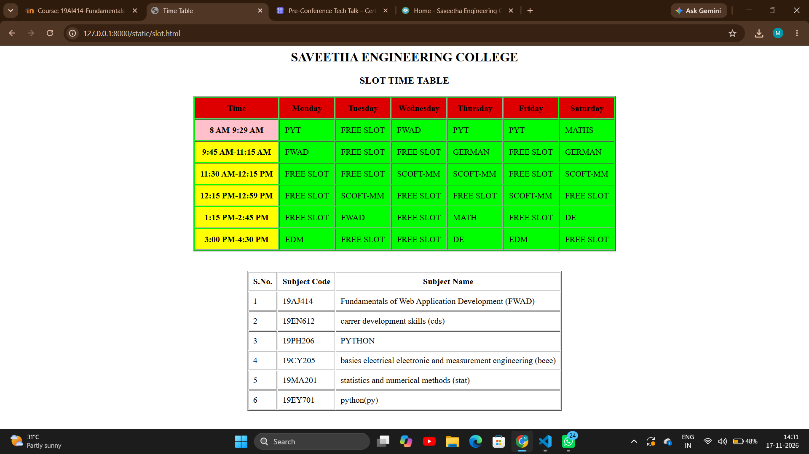

# Ex02 Time Table
## Date:

## AIM
To write a html webpage page to display your slot timetable.

## ALGORITHM
### STEP 1
Create a Django-admin Interface.

### STEP 2
Create an App inside the Django project.

### STEP 2
Create a static folder uder the created App and insert HTML code.

### STEP 3
Create a simple table using ```<table>``` tag in html with the relevant attributes.

### STEP 4
Add rows using ```<tr>``` tag.

### STEP 5
Add your course schedule using ```<td>``` tag.

### STEP 6
Execute the program using runserver command.

## PROGRAM
```<html>
    <head>
    <title>Time Table</title>
</head>
<body>

<center>
    <h2>SAVEETHA ENGINEERING COLLEGE</h2>
    <h3>SLOT TIME TABLE</h3>

    <table border="2" cellpadding="10" bgcolor="lime">
        <tr bgcolor="deepturquoise">
            <th>Time</th>
            <th>Monday</th>
            <th>Tuesday</th>
            <th>Wednesday</th>
            <th>Thursday</th>
            <th>Friday</th>
            <th>Saturday</th>
        </tr>

        <tr>
            <th bgcolor="pink">8 AM-9:29 AM</th>
            <td>PYT</td>
            <td>FREE SLOT</td>
            <td>FWAD</td>
            <td>PYT</td>
            <td>PYT</td>
            <td>MATHS</td>    
        </tr>

        <tr>
            <th bgcolor="yellow">9:45 AM-11:15 AM</th>
            <td>FWAD</td>
            <td>FREE SLOT</td>
            <td>FREE SLOT</td>
            <td>GERMAN</td>
            <td>FREE SLOT</td>
            <td>GERMAN</td>
        </tr>
        <tr>
            <th bgcolor="yellow">11:30 AM-12:15 PM</th>
            <td>FREE SLOT</td>
            <td>FREE SLOT</td>
            <td>SCOFT-MM</td>
            <td>SCOFT-MM</td>
            <td>FREE SLOT</td>
            <td>SCOFT-MM</td>
        </tr>
        <tr>
            <th bgcolor="yellow">12:15 PM-12:59 PM</th>
            <td>FREE SLOT</td>
            <td>SCOFT-MM</td>
            <td>FREE SLOT</td>
            <td>FREE SLOT</td>
            <td>SCOFT-MM</td>
            <td>FREE SLOT</td>
        </tr>

        

        <tr>
            <th bgcolor="yellow">1:15 PM-2:45 PM</th>
            <td>FREE SLOT</td>
            <td>FWAD</td>
            <td>FREE SLOT</td>
            <td>MATH</td>
            <td>FREE SLOT</td>
            <td>DE</td>
        </tr>

        <tr>
            <th bgcolor="yellow">3:00 PM-4:30 PM</th>
            <td>EDM</td>  
            <td>FREE SLOT</td>
            <td>FREE SLOT</td>
            <td>DE</td>
            <td>EDM</td>
            <td>FREE SLOT</td>
        </tr>
    </table>

    <br><br>

    <table border="1" cellpadding="8">
        <tr>
            <th>S.No.</th>
            <th>Subject Code</th>
            <th>Subject Name</th>
        </tr>

        <tr>
            <td>1</td>
            <td>19AJ414</td>
            <td>Fundamentals of Web Application Development (FWAD)</td>
        </tr>

        <tr>
            <td>2</td>
            <td>19EN612</td>
            <td>carrer development skills (cds)</td>
        </tr>

        <tr>
            <td>3</td>
            <td>19PH206</td>
            <td>PYTHON</td>
        </tr>

        <tr>
            <td>4</td>
            <td>19CY205</td>
            <td>basics electrical electronic and measurement engineering (beee)</td>
        </tr>

        <tr>
            <td>5</td>
            <td>19MA201</td>
            <td>statistics and numerical methods (stat)</td>
        </tr>

        <tr>
            <td>6</td>
            <td>19EY701</td>
            <td>python(py)</td>
        </tr>
    </table>
</center>

</body>
</html>
```

## OUTPUT


## RESULT
The program for creating slot timetable using basic HTML tags is executed successfully.
